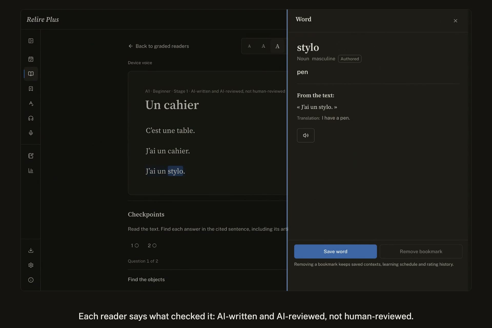
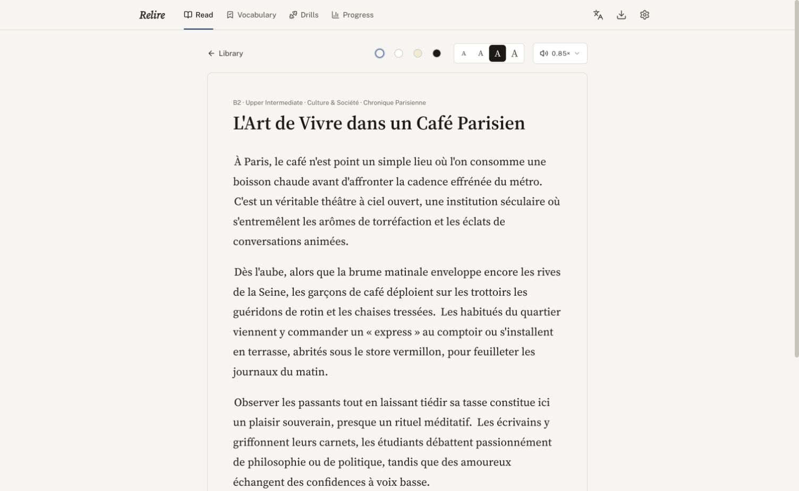
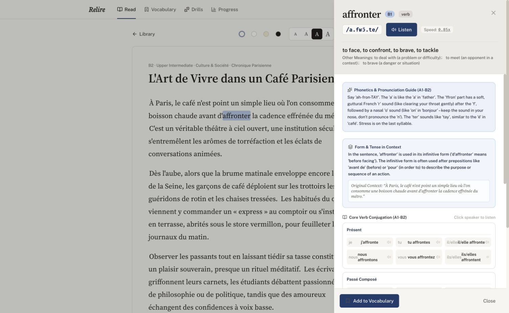
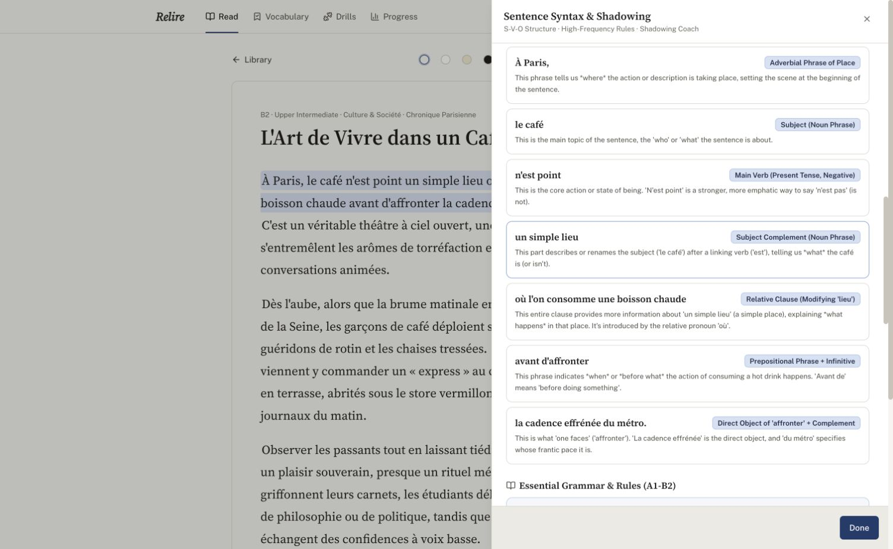

# Relire Plus

**Open-source French close reading, pronunciation and exercise practice for TCF Canada learners.**

Reading French with a dictionary open breaks your flow, and reading without one leaves the details vague. Practising pronunciation on your own gives you no feedback on rhythm, liaisons or single sounds. Relire Plus puts close reading, shadowing and exercises in one browser app: you read real French, check each word and sentence in context, and get feedback on how you sound.

[Try Relire Plus online](https://royisme.github.io/relire/) · **English** · [简体中文](README.zh-CN.md)

[](docs/media/overview.en.mp4)

_A 30-second recording of the real app. Select the image to play it._

## A look inside

Read a French article with adjustable text size and playback speed.



Tap a word to see its meaning in context, IPA and pronunciation guidance beside the article.



Break down a sentence into grammatical parts while keeping the original text in view.



<details>
<summary>Article library and shadowing guide</summary>

Search and filter articles by CEFR level.


Follow the sentence translation and shadowing guide, and adjust playback speed as you practise.


</details>

## What works without a key

- **Start on Today**: The app opens on Today with a queue drawn from your own activity: words to review, a graded reader, sound pairs, mistakes to redo, and the next grammar topic when available.
- **Read graded readers**: An ordered starter collection for zero-basis learners with authored word meanings, revealable sentence translations, saved vocabulary, device-voice audio, and local checkpoints; each reader can also turn its own sentences into a negation or singular/plural practice set, computed by rule with no AI and no key.
- **Vocabulary review in Words**: Spaced-repetition review scheduled with FSRS-6. You rate each word Forgot, Fuzzy, or Remembered. Play offers retrieval challenges before answers are revealed, and Map displays saved words, imported lists, and downloaded wordbook pages.
- **Reviewed conjugation**: Complete conjugation tables for 19 reviewed French verbs answered directly from local data without AI, plus conjugation practice sets generated without an AI call.
- **Noun-gender reference**: 17 noun-ending tendencies with examples and exceptions, plus standalone gender-check drills.
- **French sounds and Sound pairs**: A complete chart of French sounds in IPA with tap-to-hear audio via device speech, and Sound pairs listening drills under Speaking.
- **Mistake notebook and progress tracking**: Mistakes keeps your latest wrong answer for each exercise item and marks it resolved after a later correct attempt. Progress tracks real counts for saved words, shadowing sessions, pronunciation scores, and grammar accuracy.
- **Article library and reading tools**: Browse the three included sample articles or paste text, with adjustable font size, light and dark themes, and playback speed down to 0.5×.
- **Import vocabulary lists**: Import words from `.txt`, `.tsv`, `.csv`, or Anki `.apkg` files into your vocabulary deck. Recognized trailing part-of-speech tags (such as `n.m.` or `v.pr.`) move to the start of the back, leaving only the word on the front and for read-aloud. Imported decks are listed in Settings → Words, where you choose the one wordbook to study or delete a deck.
- **Bilingual interface and prompt editing**: English and Simplified Chinese interfaces, and plain-text prompt templates you can inspect, edit, or reset in Settings.
- **Local-first offline storage**: Articles, saved words, exercise history, mistake records, and cached audio stay on your device in IndexedDB and work offline.

## What needs a key or a service

- **Context-aware word and sentence lookups**: Tap any word in an imported article for its meaning in context, lemma, IPA, and verb tense. Expand sentences for syntax breakdowns, grammar points, collocations, and shadowing guidance. (Requires a text AI key, or local Ollama with no key).
- **Pronunciation assessment**: Record yourself reading a sentence aloud. Azure Speech evaluates accuracy, fluency, and individual words; Gemini assesses the audio directly for phonemes, liaisons, and intonation; other text AI providers give transcript-based guidance where a transcript is available.
- **Exercise generation and AI grading**: Generate exercise sets (fill-in-the-blank, multiple choice, word transformation, reading passages, dialogue ordering, and more) from your articles, or import worksheets from images or PDFs. Open answers are evaluated by an AI in words rather than a score.
- **Article and worksheet OCR**: Import articles or exercises from up to five photos or PDF pages read by your selected vision model.
- **AI speech synthesis**: Listen to articles and sentences with Gemini, Fish Audio or a local Ollama Phonon model (Ollama and device speech need no key). Phonon needs Ollama 0.40.9+ on Apple Silicon; the 40M models are licensed CC BY-NC 4.0 for noncommercial use and are pulled by the learner, not shipped with the app.
- **Unreviewed verb conjugation**: For verbs outside the 19 reviewed verbs, an AI generates the conjugation, which is checked against the app's grammar rules and labelled accordingly.
- **Optional content service**: Connect an optional read-only service with your own access key to download grammar topics and wordbook pages. The service never receives your AI key, answers, articles, or audio.

## In numbers

You can reproduce each count with `bun scripts/readme-numbers.ts` or the one-line commands below:

| Item | Count | Source / Command |
| --- | ---: | --- |
| Bundled graded readers | 3 | `bun -e 'console.log((await Bun.file("src/data/graded-readers/starter.json").json()).readers.length)'` |
| Sample articles | 3 | `grep -c 'id: ' src/data/sampleArticles.ts` |
| Reviewed verbs in conjugation pack | 19 | `bun -e 'console.log(Object.keys((await Bun.file("src/data/grammar-pack/pack.json").json()).verbs).length)'` |
| Noun-ending tendencies | 17 | `bun -e 'console.log((await Bun.file("src/data/noun-gender/pack.json").json()).rules.length)'` |
| Exercise types | 11 | `grep -cE "^\s+'[A-Z_]+'," src/types/exercises.ts` |
| UI languages | 2 | `ls src/i18n/locales/*.json \| wc -l \| tr -d ' '` |

## How it is made and what to trust

- **Who reviewed what**: The data files record the maintainer as the reviewer of the 19 reviewed verbs and the noun-gender pack (17 ending tendencies and 337 example nouns). The bundled graded readers and the letter-sound patterns were reviewed by AI models, among them Gemini 4 Argon, Gemini 3.8 Flash and GPT 6.1 sol, each independent of the model that wrote the text. Neither set was reviewed by a human teacher, and each reader says so on its page.
- **AI scores are estimates**: Pronunciation scores and open-question feedback from AI models are estimates, not official exam marks.
- **No official affiliation**: Relire Plus is an independent open-source practice tool. It is not a TCF mock-exam platform, and it is not affiliated with France Éducation international or Immigration, Refugees and Citizenship Canada (IRCC).
- **Words ratings reflect self-reported recall**: FSRS-6 review scheduling relies entirely on your own rating (Forgot, Fuzzy, or Remembered), not automated tests. In Words Play mode, answering a retrieval challenge before reveal never changes the review schedule.
- **Gender practice counts first tries**: In the noun-gender practice game, only your first attempt on each card counts toward history; returning cards that you missed write nothing.

<!-- DRAFT Q8: needs the owner's wording before release -->
I built Relire Plus with AI coding agents under my direction. They wrote the code and drafted most of the content. Automated checks cover the code, the data shapes and the conjugation tables against reference data. The French in the graded readers was reviewed by AI models, among them Gemini 4 Argon, and no human teacher has reviewed it yet. A human language review is the release gate for beginners.

## Try it online

Open **https://royisme.github.io/relire/**. You can browse the included sample articles immediately. Today and the graded readers work without a key. AI analysis, AI speech and pronunciation scoring need a key for the provider you choose, except Ollama and the device voice.

## Quick start

You need [Bun](https://bun.sh). For the AI features you also need a key from one of the providers above (Ollama needs none), for example a free [Gemini API key](https://aistudio.google.com/apikey).

```bash
git clone https://github.com/royisme/relire.git
cd relire
bun install
bun run dev        # http://localhost:5173
```

On first launch, when the selected text provider needs a key and none is saved, a three-step guide opens. You can create and check a key there or choose **Continue without AI**, and add a key later in **Settings**. Word and sentence analysis, AI audio and pronunciation feedback need a key unless you use Ollama or the device voice. While the selected text provider needs a key and none is saved, a banner offers to add one on every page except Today, the graded readers and Settings.

### Run it as an installed app

```bash
bun run build      # static files in dist/
bun run preview    # serve them locally
```

`dist/` is a plain static site, so you can also host it anywhere (GitHub Pages, Netlify, an S3 bucket). Open it in Chrome, Edge or Safari and use the browser's install option; it then opens in its own window. Installing needs `localhost` or HTTPS.

Once the app is installed, what is stored on your device works offline: your articles, saved words and review, the bundled graded readers, reviewed conjugation, the noun-gender reference, mistakes and cached audio. Anything that calls an AI provider or the optional content service needs a connection; Ollama needs only your own machine.

### Privacy

Your articles, vocabulary and stats are stored in this browser's IndexedDB, and your API key and settings in its local storage. You can export and restore a backup from Settings (backups never include the key). Browsers can clear site data when space runs low or after long inactivity, particularly Safari for sites that are not installed, so install the app, use **Protect my data** in Settings, and export a backup now and then. When you use an AI feature, the word, sentence or recording is sent from your browser straight to the AI provider you choose, using your key where the provider needs one. The fonts are bundled with the app, so nothing is requested from Google Fonts. Browser speech recognition is off by default. If you enable it, your browser may send microphone audio to the browser maker's speech service for transcription while you record, before you press Check pronunciation. Device speech uses browser or operating-system voices; network use depends on the voice. The app also contacts its host and, if you test or enable it, the optional content service. Like any web server they see your IP address. The content service also receives the service access key you set for it and the ids of the topics, books or readers you open. Neither of them ever sees your AI key, answers, articles or recordings. Generated explanations, drills and pronunciation audio are cached on your device. Reusing a cached result or audio clip needs no further API call, and cached audio works offline. Word analyses have no expiry; sentence analyses and drills expire after 30 days. Audio for saved vocabulary is protected from automatic cleanup; other clips may be removed when the audio store exceeds 200 MB. Settings shows what is saved and can clear it, and a backup can optionally include your vocabulary's audio. Anyone with access to your browser profile can read the stored key, so use a key you can revoke.

## How it is built

React 19, Vite, Tailwind CSS 4, i18next, and AI providers called directly from the browser (Gemini through `@google/genai`, Azure through its Speech SDK, OpenAI-compatible, Anthropic, Ollama and Fish Audio over `fetch`). `PRODUCT.md` describes who it is for and the principles behind it, `DESIGN.md` is the visual system, `docs/architecture.md` is a map of the code, and `CLAUDE.md` plus `.claude/` hold the guidance for AI coding agents.

```
src/services/ai/         providers, prompt templates and tasks; the UI calls src/services/api.ts
src/App.tsx              app wiring: route, key request and the first-run guide
src/storage/             IndexedDB persistence, answer cache and audio storage
src/components/          screens and overlays, grouped by area
src/utils/srs.ts         FSRS-6 scheduling
```

`bun run typecheck` runs the TypeScript check, `bun run lint` runs oxlint, `bun run format` formats with oxfmt, and `bun run e2e` runs the Playwright specs with every AI call mocked.

## Contributing

Issues and pull requests are welcome. Please read `PRODUCT.md` and `DESIGN.md` before changing the UI, and keep every user-facing string in both `src/i18n/locales/en.json` and `zh.json`.

## License

[MIT](LICENSE) for the code and documentation. The dictionary data files under `data/lexicon/` are a work based on Morphalou 3.1 and are licensed under the LGPL-LR; see [data/lexicon/NOTICE.md](data/lexicon/NOTICE.md) and [data/lexicon/LGPL-LR.txt](data/lexicon/LGPL-LR.txt).
