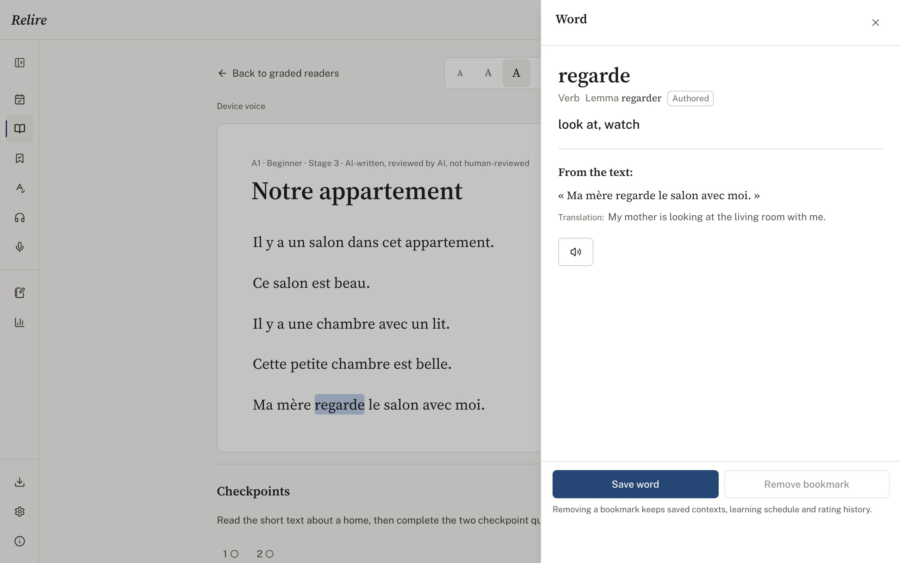
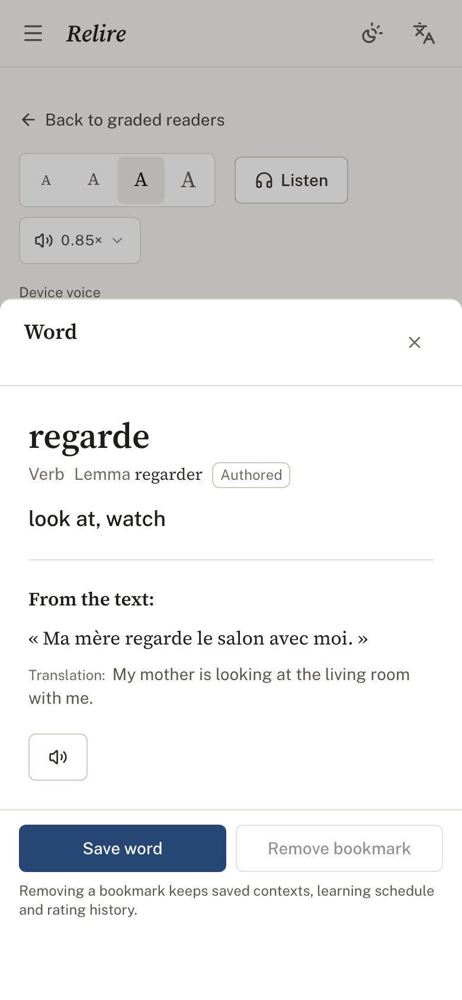
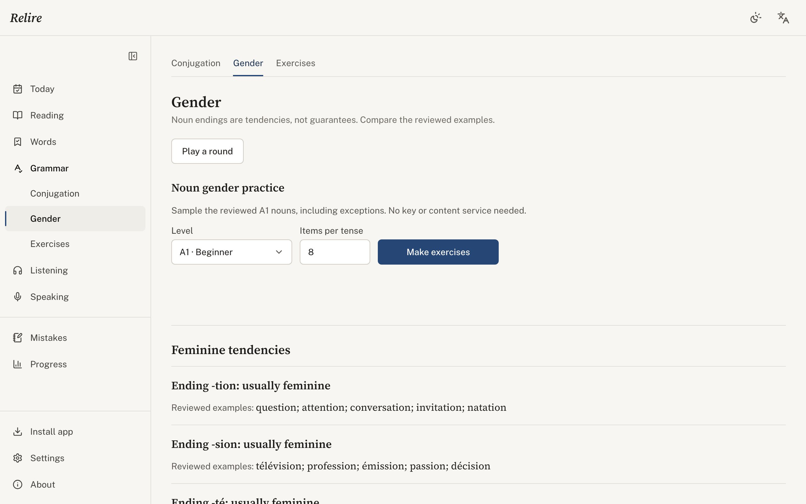
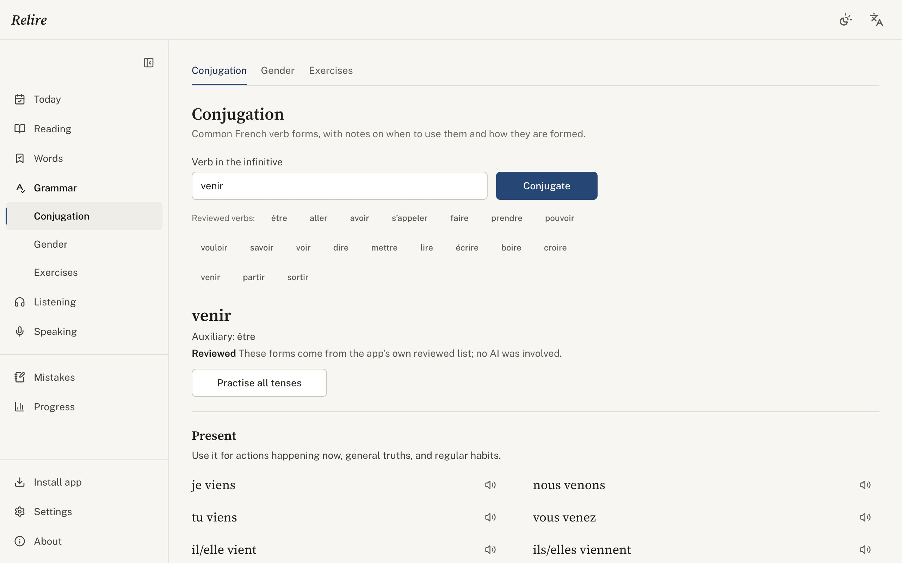

<div align="center">

<a href="https://royisme.github.io/relire/"></a>

# Relire

**Read French closely. Then say it out loud.**

I am learning French for TCF Canada, so I built the reading tool I wanted. It runs in your browser with no account. Your learning data is stored on your device; when you use an AI feature, what you ask about goes straight to the provider you pick.

[**Open Relire →**](https://royisme.github.io/relire/) · [简体中文](README.zh-CN.md)

<sub>Word and sentence lookups in articles, pronunciation feedback and AI speech use your own key for the provider you pick (local Ollama needs none).
Graded readers, reviewed conjugation and the noun-gender reference work with no key.</sub>

</div>

## Read, understand, say it

**Tap a word.** In a graded reader you see its meaning and the sentence it came from, with no key. In an article you paste or import, the lookup also gives IPA, verb forms and examples; that uses a text AI key (local Ollama needs none).

<table>
<tr>
<td width="64%"></td>
<td></td>
</tr>
</table>

**Open a sentence in a pasted or imported article.** It splits into labelled parts, with grammar points, collocations and a shadowing guide beside the original text. Needs a text AI key, or local Ollama with no key.

**Say it back.** Play the sentence and record yourself. Compare plays the reference first, then your take. The last three takes of each sentence stay on your device. Recording needs no key. Graded readers use the device voice for the reference; elsewhere, choose Device voice in Settings to compare without a key.

## No key? Start here

- [Graded readers](https://royisme.github.io/relire/#/read/graded): three starter readers with authored word meanings, revealable sentence translations, device-voice audio and local checkpoints.
- [Noun gender](https://royisme.github.io/relire/#/grammar/gender): 17 ending tendencies with reviewed examples and exceptions, a le/la round and drills. The tendencies were measured against the dictionary in `src/data/noun-gender/pack.json` (reproduce with `bun scripts/readme-numbers.ts`): -tion is feminine in 3,780 of 3,794 nouns, -age is masculine in 3,091 of 3,105, -ure is feminine in 902 of 1,216; 337 example nouns are reviewed.
- [Conjugation](https://royisme.github.io/relire/#/grammar/conjugation): complete tables for 19 reviewed verbs, answered from local data with no AI call, plus negation and question patterns.
- [French sounds and Sound pairs](https://royisme.github.io/relire/#/speaking): the IPA chart and sound-pair listening drills. Audio plays through the speech provider you selected; choose Device voice in Settings to hear it without a key.

<table>
<tr>
<td width="50%"></td>
<td></td>
</tr>
</table>

## With your own key

- **Article lookups**: word and sentence analysis in any article you paste or import. (Text AI key; local Ollama needs none.)
- **Pronunciation feedback**: Azure Speech scores accuracy, fluency and single words; Gemini listens for phonemes, liaisons and intonation. Scores are estimates.
- **Generated exercises**: fill-in-the-blank, multiple choice, word transformation, reading passages, dialogue ordering and more, made from your articles; open answers are judged in words, not scored.
- **Article and worksheet OCR**: import from up to five photos or PDF pages, read by the vision model you choose.
- **AI speech**: Gemini or Fish Audio with your key, or a local Ollama Phonon model, which needs only one pulled model, no key and no account (Ollama 0.40.9+ on Apple Silicon; the 40M models are CC BY-NC 4.0, noncommercial, and are pulled by you, not shipped with the app). Ollama and the device voice need no key.
- **Conjugation for other verbs**: an AI writes the table and the app checks it against its own rules; the result is labelled, never "verified".
- **Optional content service**: a read-only service, with your own access key, for grammar topics and wordbook pages. It never sees your AI key, answers, articles or recordings.

## What to trust

- **No account, no app server.** Articles, words, recordings and settings stay in your browser, and AI calls go straight from your browser to the provider you pick. The only backend is an optional read-only content service.
- **Who reviewed what**: The data files record the maintainer as the reviewer of the 19 reviewed verbs and the noun-gender pack (17 ending tendencies and 337 example nouns). The bundled graded readers and the letter-sound patterns were reviewed by AI models, each reviewer a different model from the one that wrote the text. Neither set was reviewed by a human teacher, and each reader says so on its page.
- **AI scores are estimates**: Pronunciation scores and open-question feedback from AI models are estimates, not official exam marks.
- **No official affiliation**: Relire is an independent open-source practice tool. It is not a TCF mock-exam platform, and it is not affiliated with France Éducation international or Immigration, Refugees and Citizenship Canada (IRCC).
- **Words ratings reflect self-reported recall**: FSRS-6 review scheduling relies entirely on your own rating (Forgot, Fuzzy, or Remembered), not automated tests. In Words Play mode, answering a retrieval challenge before reveal never changes the review schedule.
- **Gender practice counts first tries**: In the noun-gender practice round, only your first attempt on each card counts toward history; returning cards that you missed write nothing.

I built Relire with AI coding agents under my direction. They wrote the code and drafted most of the content. Automated checks cover the code, the data shapes and the conjugation tables against reference data. The French in the graded readers was reviewed by other AI models, and no human teacher has reviewed it yet. A human language review is the release gate for beginners.

## In numbers

Every count in this table comes from this repository; `bun scripts/readme-numbers.ts` prints them.

| Item | Count | Source |
| --- | ---: | --- |
| Bundled graded readers | 3 | `src/data/graded-readers/starter.json` |
| Sample articles | 3 | `src/data/sampleArticles.ts` |
| Reviewed verbs in conjugation pack | 19 | `src/data/grammar-pack/pack.json` |
| Noun-ending tendencies | 17 | `src/data/noun-gender/pack.json` |
| Noun ending -tion, feminine in the dictionary | 3780 of 3794 | `src/data/noun-gender/pack.json` |
| Noun ending -age, masculine in the dictionary | 3091 of 3105 | `src/data/noun-gender/pack.json` |
| Noun ending -ure, feminine in the dictionary | 902 of 1216 | `src/data/noun-gender/pack.json` |
| Reviewed nouns in the noun-gender pack | 337 | `src/data/noun-gender/pack.json` |
| Exercise types | 11 | `src/types/exercises.ts` |
| UI languages | 2 | `src/i18n/locales/` |

<details>
<summary>The one-line commands behind each count</summary>

```bash
bun -e 'console.log((await Bun.file("src/data/graded-readers/starter.json").json()).readers.length)'
grep -c 'id: ' src/data/sampleArticles.ts
bun -e 'console.log(Object.keys((await Bun.file("src/data/grammar-pack/pack.json").json()).verbs).length)'
bun -e 'console.log((await Bun.file("src/data/noun-gender/pack.json").json()).rules.length)'
bun -e 'const p=(await Bun.file("src/data/noun-gender/pack.json").json());const r=p.rules.find(v=>v.id==="tion");console.log(`${r.dictionary.agree} of ${r.dictionary.n}`)'
bun -e 'const p=(await Bun.file("src/data/noun-gender/pack.json").json());const r=p.rules.find(v=>v.id==="age");console.log(`${r.dictionary.agree} of ${r.dictionary.n}`)'
bun -e 'const p=(await Bun.file("src/data/noun-gender/pack.json").json());const r=p.rules.find(v=>v.id==="ure");console.log(`${r.dictionary.agree} of ${r.dictionary.n}`)'
bun -e 'console.log((await Bun.file("src/data/noun-gender/pack.json").json()).nouns.filter(n=>n.prov.status==="reviewed").length)'
grep -cE "^\s+'[A-Z_]+'," src/types/exercises.ts
ls src/i18n/locales/*.json | wc -l | tr -d ' '
```

</details>

## Try it

Open **https://royisme.github.io/relire/**. Today, the graded readers, noun gender and conjugation of the reviewed verbs work without a key. AI lookups, AI speech and pronunciation feedback need a key for the provider you choose, except Ollama and the device voice.

## Quick start

You need [Bun](https://bun.sh). For the AI features you also need a key from one of the providers above (Ollama needs none), for example a free [Gemini API key](https://aistudio.google.com/apikey). On first launch, a three-step guide lets you add a key or continue without AI.

```bash
git clone https://github.com/royisme/relire.git
cd relire
bun install
bun run dev        # http://localhost:5173
```

`bun run build` produces a plain static site in `dist/`; host it anywhere (GitHub Pages, Netlify, an S3 bucket) and install it from Chrome, Edge or Safari so it opens in its own window. What is stored on your device then works offline; anything that calls an AI provider or the optional content service needs a connection, and Ollama needs only your own machine.

### Privacy

- Articles, words, recordings and stats stay in this browser's IndexedDB; your key and settings stay in its local storage, and backups never include the key.
- When you use an AI feature, the word, sentence or recording goes from your browser straight to the provider you choose.
- The optional content service never sees your AI key, answers, articles or recordings.
- Browsers can clear site data when space runs low; install the app and export a backup now and then.

Full detail: [PRIVACY.md](PRIVACY.md).

## How it is built

React 19, Vite, Tailwind CSS 4 and i18next, with AI providers called directly from the browser. `PRODUCT.md` says who the app is for, `DESIGN.md` is the visual system, and `AGENTS.md` holds the repository rules, checks and commands.

## Contributing

Issues and pull requests are welcome. Please read `PRODUCT.md` and `DESIGN.md` before changing the UI, and keep every user-facing string in both `src/i18n/locales/en.json` and `zh.json`.

## License

[MIT](LICENSE) for the code and documentation. The dictionary data files under `data/lexicon/` are a work based on Morphalou 3.1 and are licensed under the LGPL-LR; see [data/lexicon/NOTICE.md](data/lexicon/NOTICE.md) and [data/lexicon/LGPL-LR.txt](data/lexicon/LGPL-LR.txt).

If Relire helps your French, a star helps others find it.
