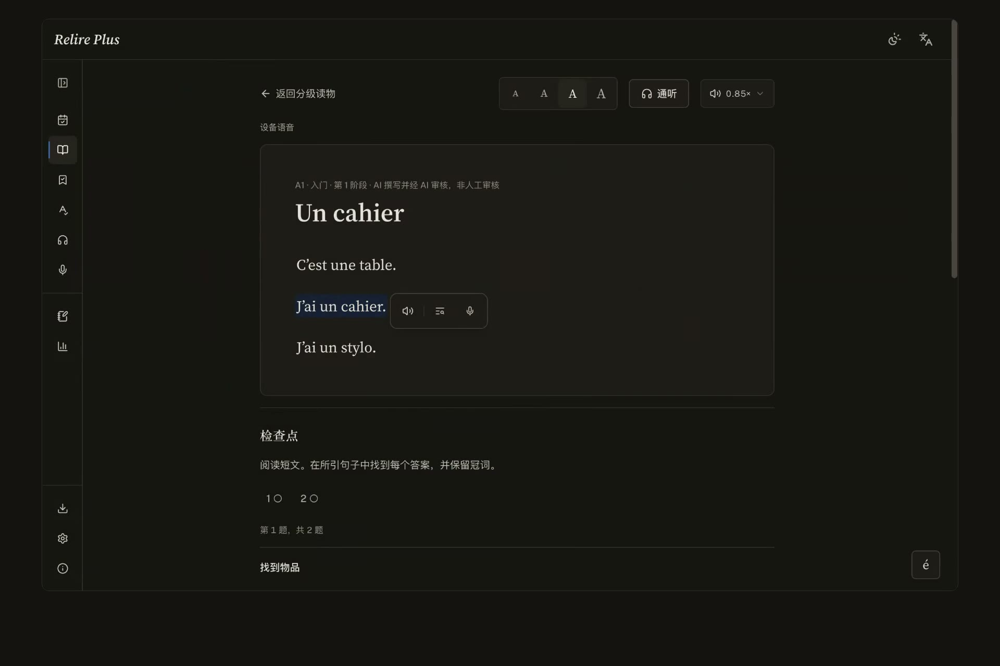
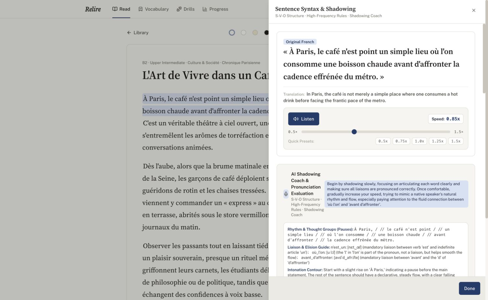

# Relire Plus

**面向 TCF Canada 学习者的开源法语精读、发音与练习工具。**

一边查词典一边读，思路容易被打断；不查，细节又读不透。单独练发音，也得不到节奏、联诵和单个音的反馈。Relire Plus 把精读、跟读和练习放进同一个浏览器应用：读真实的法语，在语境里逐词逐句弄懂，再得到发音反馈。

[在线体验 Relire Plus](https://royisme.github.io/relire/) · [English](README.md) · **简体中文**

[](docs/media/overview.zh-CN.mp4)

_真实应用的 30 秒录屏。点击图片播放。_

## 界面预览

阅读法语文章，按自己的习惯调整字号和朗读速度。


点击单词，在原文旁查看中文释义、音标和发音提示。


逐段拆解难句，结合中文讲解理解语法和句子结构。


<details>
<summary>文章库与影子跟读指南</summary>

搜索文章，按 CEFR 等级筛选。


跟随句子译文与跟读指南练习，并按需调整朗读速度。



</details>

## 无需 Key 即可使用的功能

- **从“今天”开始**：应用默认打开“今天”页，根据你自己的学习记录生成任务队列：待复习生词、分级读物、音对练习、待重做错题，以及有语法专题时的下一个专题。
- **分级读物**：面向零基础学习者的分级入门读物，包含预先编写的词义、可展开的句子译文、生词收藏、设备语音朗读以及本地检查点；每本读物还能用其中的句子生成否定句或单复数练习，答案由规则算出，不用 AI，也不需要 Key。
- **生词复习**：基于 FSRS-6 算法的间隔重复复习。你自己给每个词评估“不记得”、“模糊”或“记得”。“玩一轮”在揭晓答案前提供回忆题，“词汇地图”展示已保存的生词、导入的词表和已下载的词书页面。
- **已审核动词变位**：内置 19 个已审核法语动词的完整变位表，直接从本地数据读取，不调用 AI；可一键生成针对这些动词的变位练习。
- **名词阴阳性参考**：整理了 17 条名词词尾倾向并附带例词与例外，支持生成阴阳性专项练习。
- **发音音标表与音对练习**：“口语”页提供完整的法语国际音标表，每个音标均配有可点击朗读的示例词（使用设备语音），另有音对辨音练习。
- **错题本与进度统计**：“错题本”为每道做错的题目保留最近一次记录，并在重新答对后标记为已解决。“进度”展示已保存生词数、跟读次数、发音评分及语法正确率等真实数据。
- **文章库与阅读辅助**：浏览内置的 3 篇示例文章或直接粘贴文本，支持调整字号、切换明暗主题，并将朗读语速放慢至 0.5 倍。
- **词表导入**：支持从 `.txt`、`.tsv`、`.csv` 或 Anki `.apkg` 文件导入生词到词库。词条末尾可识别的词性缩写（如 `n.m.` 或 `v.pr.`）会移到卡片背面开头，正面和朗读只保留单词。导入的牌组会列在“设置 → 词汇”中，可以选择其中一本词书来学习（一次一本），也可以删除牌组。
- **双语界面与提示词自定义**：支持简体中文与英文界面；发给 AI 的指令均为纯文本模板，可在“设置”中查看、修改或重置。
- **本地优先离线存储**：文章、已保存生词、练习记录、错题和已缓存音频保存在本机的 IndexedDB 中，支持离线使用。

## 需要 Key 或内容服务的功能

- **语境释义与难句拆解**：在导入的文章中点击单词查看其在语境中的释义、词元、音标和时态；展开难句可查看句法成分拆解、语法点、常见搭配与跟读指南。（需要文本 AI 的 Key，使用本机 Ollama 则不需要 Key）。
- **发音评测与反馈**：录下朗读句子的声音。Azure Speech 评测发音准确度、流利度及逐词表现；Gemini 直接听录音并针对音素、联诵和语调给出反馈；其他文本 AI 提供方仅在有转写文本时提供基于转写的指导。
- **练习题生成与 AI 批改**：根据文章生成填空、选择、词形变换、短文完形、对话排序等练习题，或从练习册图片/PDF 导入题目；开放问答由 AI 用文字评判，不打分数。
- **图片与 PDF 识别导入**：通过你选定的视觉模型，从最多 5 张图片或 PDF 页面中提取文本并导入为文章或练习题。
- **AI 语音朗读**：使用 Gemini、Fish Audio 或本机 Ollama Phonon 模型（`phonon:40m-fr` 或 `phonon:40m-multilingual`）朗读文章和句子；Phonon 是配置最少的本地方案：拉取一个模型即可，不需要 Key，也不需要账号（Ollama 和设备语音不需要 Key）。Phonon 需要 Apple Silicon 上的 Ollama 0.40.9 及以上版本；40M 模型采用 CC BY-NC 4.0 许可，仅限非商业用途，由学习者自行拉取，不随应用分发。
- **未审核动词变位**：对于 19 个已审核动词之外的其他动词，由 AI 生成变位结果并与应用内置规则比对，明确标注核对状态。
- **可选内容服务**：通过填入服务访问 Key 连接只读内容服务，用于下载语法专题与词书页面。该服务绝不会收到你的 AI Key、答题记录、文章或录音。

## 数据指标

所有数据均可通过 `bun scripts/readme-numbers.ts` 或下方单行命令复现：

| 项目 | 数量 | 来源 / 命令 |
| --- | ---: | --- |
| 内置分级读物 | 3 | `bun -e 'console.log((await Bun.file("src/data/graded-readers/starter.json").json()).readers.length)'` |
| 示例文章 | 3 | `grep -c 'id: ' src/data/sampleArticles.ts` |
| 变位库中已审核动词 | 19 | `bun -e 'console.log(Object.keys((await Bun.file("src/data/grammar-pack/pack.json").json()).verbs).length)'` |
| 名词词尾阴阳性倾向 | 17 | `bun -e 'console.log((await Bun.file("src/data/noun-gender/pack.json").json()).rules.length)'` |
| 题型种类 | 11 | `grep -cE "^\s+'[A-Z_]+'," src/types/exercises.ts` |
| 界面语言 | 2 | `ls src/i18n/locales/*.json \| wc -l \| tr -d ' '` |

## 制作方式与真实局限

- **谁审核了什么**：数据文件里记录的审核人是维护者本人，涉及 19 个已审核动词和名词阴阳性包（17 条词尾倾向、337 个例词）。内置的分级读物和拼读发音规则由多个 AI 模型审核，其中有 Gemini 4 Argon、Gemini 3.8 Flash 和 GPT 6.1 sol，每个审核模型都独立于写出文本的模型。两者都没有人类教师审核，每篇读物在页面上都会这样标明。
- **AI 评分仅为估计值**：AI 给出的发音评分和开放题评判均为估计值，并非官方考试成绩。
- **与官方机构无关**：Relire Plus 是独立的开源练习工具，不是 TCF 模考平台，与 France Éducation international 或加拿大移民部（IRCC）没有任何关联。
- **生词复习基于自主评价**：FSRS-6 间隔重复调度完全依据你自己选择的“不记得”、“模糊”或“记得”，而非程序自动判定。在“玩一轮”模式中，揭晓答案前的回忆答题绝不会改变复习计划。
- **名词阴阳性练习仅记录首次作答**：在阴阳性练习中，只有每张卡片的首次作答会记入练习记录；答错后再次出现的卡片不会记录成绩。

<!-- DRAFT Q8: needs the owner's wording before release -->
Relire Plus 是我借助 AI 编码智能体、在我的指导下做出来的：代码由它们编写，大部分内容由它们起草。自动检查覆盖代码、数据结构，以及对照参考数据的动词变位表。分级读物里的法语由多个 AI 模型审核（其中有 Gemini 4 Argon），还没有人类教师审核过。面向初学者发布之前，必须先完成人工语言审核。

## 在线体验

打开 **https://royisme.github.io/relire/** 即可浏览内置示例文章。“今天”页和分级读物不需要 Key。AI 解析、AI 语音和发音评分需要你所选提供方的 Key，Ollama 和设备语音除外。

## 快速开始

需要 [Bun](https://bun.sh)。使用 AI 功能还需要上面列出的某个提供方的 Key（Ollama 不需要），例如免费的 [Gemini API Key](https://aistudio.google.com/apikey)。

```bash
git clone https://github.com/royisme/relire.git
cd relire
bun install
bun run dev        # http://localhost:5173
```

第一次打开时，如果所选文本提供方需要 Key 而你还没有保存，会出现三步引导。可以在那里创建并检查 Key，也可以选**不用 AI，继续**，之后再到**设置**里添加。单词和句子解析、AI 音频、发音反馈需要 Key，用 Ollama 或设备语音则不需要。所选文本提供方需要 Key 而尚未保存时，除“今天”、分级读物和设置外，每个页面上都会有一条横幅提示添加。

### 作为应用安装

```bash
bun run build      # 静态文件输出到 dist/
bun run preview    # 在本地预览
```

`dist/` 就是普通的静态网站，也可以放到任何地方（GitHub Pages、Netlify、S3 等）。用 Chrome、Edge 或 Safari 打开后，选择浏览器的“安装”选项，它就会在独立窗口里运行。安装需要 `localhost` 或 HTTPS。

安装后，保存在设备上的内容可以离线使用：你的文章、已保存的生词和复习、内置的分级读物、已审核的变位、名词阴阳性参考、错题和已缓存的音频。凡是要调用 AI 服务商或可选内容服务的功能都需要联网；Ollama 只需要你自己的电脑。

### 隐私

文章、生词和统计数据保存在这个浏览器的 IndexedDB 里，API Key 和设置保存在本地存储里。可以在设置中导出和恢复备份（备份文件不包含 Key）。浏览器在空间不足或长期不使用时可能清掉网站数据，Safari 对没有安装的网站尤其如此，所以请安装成应用、在设置里点“保护我的数据”，并定期导出备份。使用 AI 功能时，单词、句子或录音会在提供方需要时用你的 Key 从浏览器直接发给你选择的 AI 服务商。字体已随应用打包，不会向 Google Fonts 发任何请求。浏览器语音识别默认关闭。开启后，浏览器可能在你录音时将麦克风音频发送给浏览器厂商的语音服务进行转写，不必等到你点击“评测发音”。设备语音使用浏览器或操作系统提供的声音，是否联网取决于所用声音。应用还会连接提供应用的主机，以及你测试或开启后才会使用的可选内容服务。它们和任何网站服务器一样能看到你的 IP 地址。内容服务还会收到你为它设置的服务访问 Key，以及你打开的专题、书或读本的 ID。两者都不会看到你的 AI Key、答案、文章或录音。生成的解析、练习题和发音音频会缓存在你的设备上。复用已缓存的结果或音频无需再次调用 API，已缓存的音频也可以离线播放。单词解析没有过期时间，句子解析和练习题在 30 天后过期。生词本关联的音频不会被自动清理；音频总量超过 200 MB 时，其他音频可能被清理。可以在设置里查看和清除，备份时也可以选择带上生词本的音频。能访问你浏览器配置的人可以读到保存的 Key，所以请使用可以随时撤销的 Key。

## 技术栈

React 19、Vite、Tailwind CSS 4、i18next，以及在浏览器里直接调用的 AI 提供方（Gemini 通过 `@google/genai`，Azure 通过其 Speech SDK，OpenAI 兼容、Anthropic、Ollama 和 Fish Audio 用 `fetch`）。`PRODUCT.md` 说明产品面向谁以及设计原则，`DESIGN.md` 是视觉规范，`docs/architecture.md` 是代码地图，`CLAUDE.md` 和 `.claude/` 是给 AI 编码助手的指引。

```
src/services/ai/         提供方、提示词模板和任务；界面调用 src/services/api.ts
src/App.tsx              应用串联：路由、Key 请求和首次引导
src/storage/             IndexedDB 持久化、解析缓存和音频存储
src/components/          页面和浮层，按领域分组
src/utils/srs.ts         FSRS-6 调度
```

`bun run typecheck` 运行 TypeScript 检查，`bun run lint` 运行 oxlint，`bun run format` 用 oxfmt 格式化，`bun run e2e` 运行 Playwright 端到端测试（所有 AI 请求均为模拟）。

## 参与贡献

欢迎提 issue 和 PR。修改界面前请先阅读 `PRODUCT.md` 和 `DESIGN.md`，所有面向用户的文案都要同时写进 `src/i18n/locales/en.json` 和 `zh.json`。

## 许可证

代码与文档采用 [MIT](LICENSE)。`data/lexicon/` 下的词典数据文件是基于 Morphalou 3.1 的衍生作品，采用 LGPL-LR 许可证；见 [data/lexicon/NOTICE.md](data/lexicon/NOTICE.md) 与 [data/lexicon/LGPL-LR.txt](data/lexicon/LGPL-LR.txt)。
