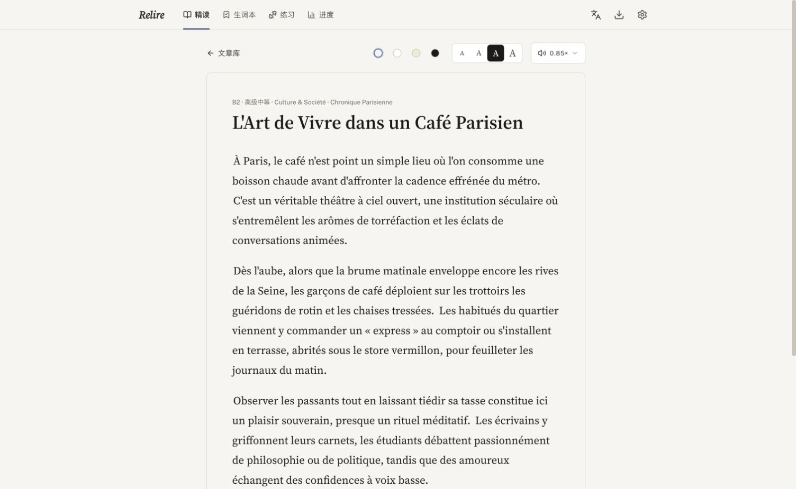
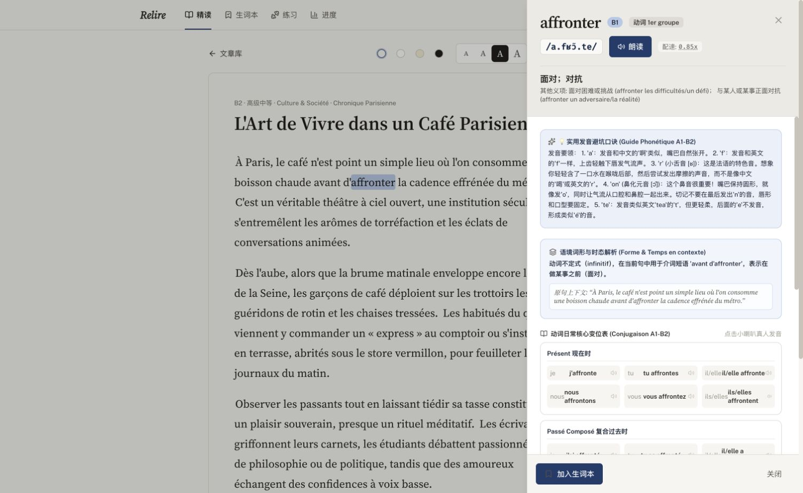
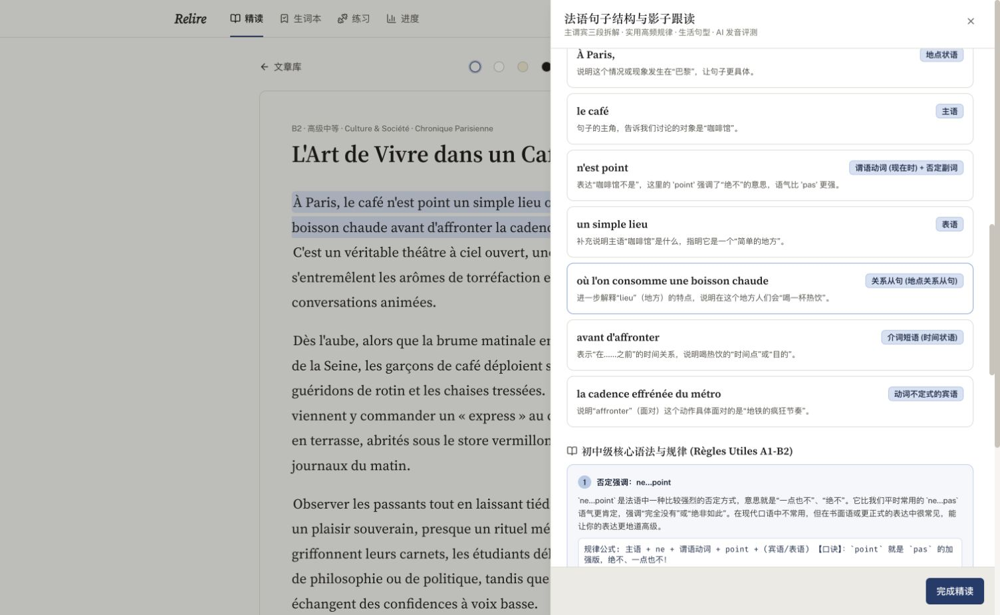
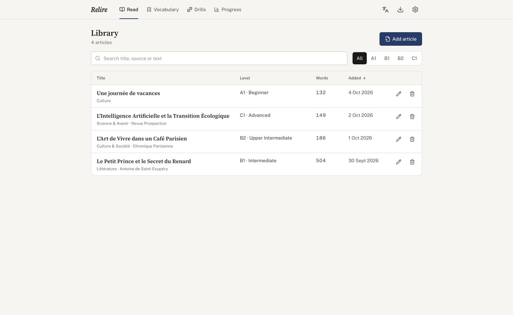

# Relire Plus — 法语精读、发音与练习

**面向 TCF Canada 学习者的开源法语精读、影子跟读、发音与练习工具。**

[在线体验 Relire Plus](https://royisme.github.io/relire/) · [English](README.md) · **简体中文**

读真实法语文章 → 点单词或句子 → 理解语境和语法 → 跟读 → 获得 AI 发音反馈 → 做练习并回顾错题。

Relire Plus 完全在浏览器中运行，没有应用服务器，也不用注册账号。AI 是可选的：需要讲解和反馈时，自带提供方和它的 Key（Ollama 不需要 Key），学习数据保存在本机，还可以把它安装成电脑或手机上的 PWA。

**为什么用 Relire Plus**

- 单词语境释义、IPA 和动词时态，另有变位页：已审核的变位表，以及经规则核对的变位。
- 句子翻译、语法拆解、常见搭配和跟读指导。
- 发音反馈：Azure Speech 给你的录音打分，Gemini 可以评估录音，其他文本 AI 只在有转写文本时给出基于转写的指导。
- 共 11 种题型，包括数字听写，可从你的材料生成或从练习册导入；开放题由 AI 用文字评判，不打分。
- 从图片、PDF 或文本导入材料，错题收进笔记本，进度来自真实练习。
- 基于 FSRS-6 的间隔重复生词复习。
- “今天”页、分级读物、生词复习、已审核的变位和名词性别参考，不用 AI Key 也能使用。
- 本地优先存储，并缓存音频和 AI 结果。
- 支持英文和简体中文界面。

> Relire Plus 覆盖阅读、发音和练习，不是 TCF 模考平台。AI 打分只是估计值，不是官方成绩；项目与 France Éducation international、IRCC 没有任何关联。

## 界面预览

阅读法语文章，按自己的习惯调整字号和朗读速度。



点击单词，在原文旁查看中文释义、音标和发音提示。



逐段拆解难句，结合中文讲解理解语法和句子结构。



<details>
<summary>查看文章库</summary>

搜索文章，按 CEFR 等级筛选。



</details>

## 能做什么

- **从“今天”开始。** 应用打开就是“今天”页：根据你自己的学习记录列出几个步骤（该复习的生词、一篇分级读物、音对练习、要重做的错题，以及有语法专题时的下一个专题），并链接到词汇、阅读、口语和语法。不需要 Key。
- **读分级读物。** 有序的入门列表，带预先写好的词义、可展开的句子译文、生词收藏、用设备语音朗读和本地检查点。不需要 Key 或服务。读物经过 AI 审核，不是人工审核。
- **管理自己的文章库。** 内置三篇 B1 到 C1 的示例，也可以粘贴自己的文章，或从图片、PDF（由你的 AI 识别）或文本导入，并在列表里搜索、按等级筛选、排序、编辑和删除。字号和主题可调，朗读速度最低可到 0.5 倍。
- **点任何一个单词。** 查看词元、语境中的释义、国际音标（IPA）、动词时态和例句。已审核名单里的动词，词条会直接显示变位表，不调用 AI；其他动词链接到变位页。一键加入生词本。
- **拆解难句。** 译文、句法成分、语法点、常见搭配，以及影子跟读指南（节奏群、联诵、语调）。
- **跟读并获得反馈。** 录下自己读句子的声音，得到总分。用 Azure Speech 还能得到准确度、流利度和逐词结果；由 Gemini 听录音则得到单个音素、联诵和语调的反馈；其他文本 AI 只在有转写文本时给出基于转写的指导。保留的录音在“口语”下的“跟读录音”里，可以和参考音频对比。
- **随时查法语发音。** “口语”页有用国际音标列出的法语全部发音，每个音配一个示例单词，点一下就能听，还有音对练习。
- **在“词汇”里积累词汇。** 阅读时收藏生词，或导入词表（`.txt`、`.tsv`、`.csv` 或 Anki `.apkg`）。按 FSRS-6 算法安排该复习的词，你自己给每个词选“不记得”“模糊”或“记得”。“玩一轮”会在揭晓答案前提供一道回忆题；“词汇地图”按页归类已下载的词书、导入的词表和收藏的生词，词书来自可选的内容服务。
- **练语法。** “变位”列出一个动词所支持的时态：已审核名单里的动词直接用名单回答，不调用 AI；其他动词交给 AI，再与应用自己的规则对照，所以结果只会说是否符合规则，不会说“已验证”。“名词阴阳性”列出 17 条名词词尾倾向，附例词和例外，两者都能不再调用 AI 就生成练习。语法专题来自可选的内容服务。
- **四个领域的练习。** 阅读、语法、听力和写作各自列出自己的练习集。可以根据任意文章生成填空、选择、词形变化、开放问答等题目，也可以导入练习册页面，在同一张练习页上作答，带提示、讲解和法语字符输入；也可以朗读一句话，获得发音评分。听力有数字听写；写作入口在你保存过写作练习之后才出现。
- **重做错题。** “错题本”为每道练习题保留最近一次答错的记录，按语法领域分组，之后答对就标记为已解决。
- **查看进度。** “进度”显示已收藏的生词数、发音平均分、朗读次数，以及语法正确率（真实的答对数与总数）。
- **自选 AI。** 文本、图片识别、语音和发音评分各有自己的提供方，需要模型时才有模型（Azure 和设备语音没有），每个提供方一个 Key，所有用到它的用途共用。文本和图片识别：Google Gemini、兼容 OpenAI 的服务（改 Base URL 还能接 DeepSeek、通义千问或你自己的网关）、Anthropic Claude，或在你自己电脑上运行的 Ollama（不需要 Key）。语音：Gemini、Fish Audio，或设备自带的语音（不需要 Key）。发音评分：填入 Key 和区域后用 Microsoft Azure Speech，未设置 Azure 时用文本 AI；只有 Gemini 能听到录音，其他文本提供方只在有转写文本时给出基于转写的指导。
- **编辑提示词。** 发给 AI 的指令是纯文本模板，可以在设置里查看、修改和恢复默认。
- **中英文界面。** 界面和讲解可以在中文和英文之间切换。

## 在线体验

打开 **https://royisme.github.io/relire/** 即可浏览内置示例文章。“今天”页和分级读物不需要 Key。AI 解析、AI 语音和发音评分需要你所选提供方的 Key，Ollama 和设备语音除外。

## 快速开始

需要 [Bun](https://bun.sh)。使用 AI 功能还需要上面列出的某个提供方的 Key（Ollama 不需要），例如免费的 [Gemini API Key](https://aistudio.google.com/apikey)。

```bash
git clone https://github.com/royisme/relire.git
cd relire
bun install
bun run dev        # http://localhost:5173
```

第一次打开时，如果所选文本提供方需要 Key 而你还没有保存，会出现三步引导。可以在那里创建并检查 Key，也可以选**不用 AI，继续**，之后再到**设置**里添加。单词和句子解析、AI 音频、发音反馈需要 Key，用 Ollama 或设备语音则不需要。所选文本提供方需要 Key 而尚未保存时，除“今天”、分级读物和设置外，每个页面上都会有一条横幅提示添加。

### 作为应用安装

```bash
bun run build      # 静态文件输出到 dist/
bun run preview    # 在本地预览
```

`dist/` 就是普通的静态网站，也可以放到任何地方（GitHub Pages、Netlify、S3 等）。用 Chrome、Edge 或 Safari 打开后，选择浏览器的“安装”选项，它就会在独立窗口里运行。安装需要 `localhost` 或 HTTPS。

安装后，保存在设备上的内容可以离线使用：你的文章、已保存的生词和复习、内置的分级读物、已审核的变位、名词性别参考、错题和已缓存的音频。凡是要调用 AI 服务商或可选内容服务的功能都需要联网；Ollama 只需要你自己的电脑。

### 隐私

文章、生词和统计数据保存在这个浏览器的 IndexedDB 里，API Key 和设置保存在本地存储里。可以在设置中导出和恢复备份（备份文件不包含 Key）。浏览器在空间不足或长期不使用时可能清掉网站数据，Safari 对没有安装的网站尤其如此，所以请安装成应用、在设置里点“保护我的数据”，并定期导出备份。使用 AI 功能时，单词、句子或录音会在提供方需要时用你的 Key 从浏览器直接发给你选择的 AI 服务商。字体已随应用打包，不会向 Google Fonts 发任何请求。浏览器语音识别默认关闭。开启后，浏览器可能在你录音时将麦克风音频发送给浏览器厂商的语音服务进行转写，不必等到你点击“评测发音”。设备语音使用浏览器或操作系统提供的声音，是否联网取决于所用声音。应用还会连接提供应用的主机，以及你测试或开启后才会使用的可选内容服务。它们和任何网站服务器一样能看到你的 IP 地址。内容服务还会收到你为它设置的服务访问 Key，以及你打开的专题、书或读本的 ID。两者都不会看到你的 AI Key、答案、文章或录音。生成的解析、练习题和发音音频会缓存在你的设备上。复用已缓存的结果或音频无需再次调用 API，已缓存的音频也可以离线播放。单词解析没有过期时间，句子解析和练习题在 30 天后过期。生词本关联的音频不会被自动清理；音频总量超过 200 MB 时，其他音频可能被清理。可以在设置里查看和清除，备份时也可以选择带上生词本的音频。能访问你浏览器配置的人可以读到保存的 Key，所以请使用可以随时撤销的 Key。

## 技术栈

React 19、Vite、Tailwind CSS 4、i18next，以及在浏览器里直接调用的 AI 提供方（Gemini 通过 `@google/genai`，Azure 通过其 Speech SDK，OpenAI 兼容、Anthropic、Ollama 和 Fish Audio 用 `fetch`）。`PRODUCT.md` 说明产品面向谁以及设计原则，`DESIGN.md` 是视觉规范，`docs/architecture.md` 是代码地图，`CLAUDE.md` 和 `.claude/` 是给 AI 编码助手的指引。

```
src/services/ai/         提供方、提示词模板和任务；界面调用 src/services/api.ts
src/App.tsx              应用串联：路由、Key 请求和首次引导
src/storage/             IndexedDB 持久化、解析缓存和音频存储
src/components/          页面和浮层，按领域分组
src/utils/srs.ts         FSRS-6 调度
```

`bun run typecheck` 运行 TypeScript 检查，`bun run lint` 运行 oxlint，`bun run format` 用 oxfmt 格式化，`bun run e2e` 运行 Playwright 端到端测试（所有 AI 请求均为模拟）。

## 参与贡献

欢迎提 issue 和 PR。修改界面前请先阅读 `PRODUCT.md` 和 `DESIGN.md`，所有面向用户的文案都要同时写进 `src/i18n/locales/en.json` 和 `zh.json`。

## 许可证

代码与文档采用 [MIT](LICENSE)。`data/lexicon/` 下的词典数据文件是基于 Morphalou 3.1 的衍生作品，采用 LGPL-LR 许可证；见 [data/lexicon/NOTICE.md](data/lexicon/NOTICE.md) 与 [data/lexicon/LGPL-LR.txt](data/lexicon/LGPL-LR.txt)。
