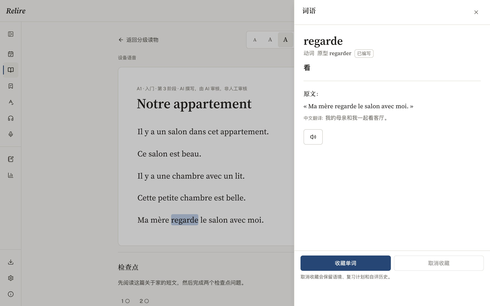
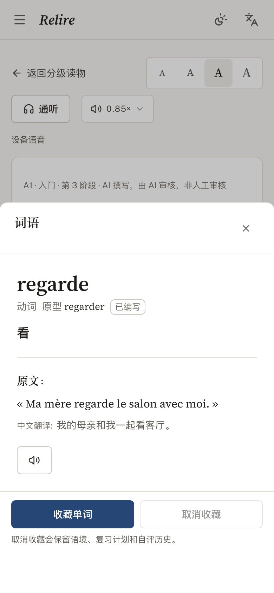
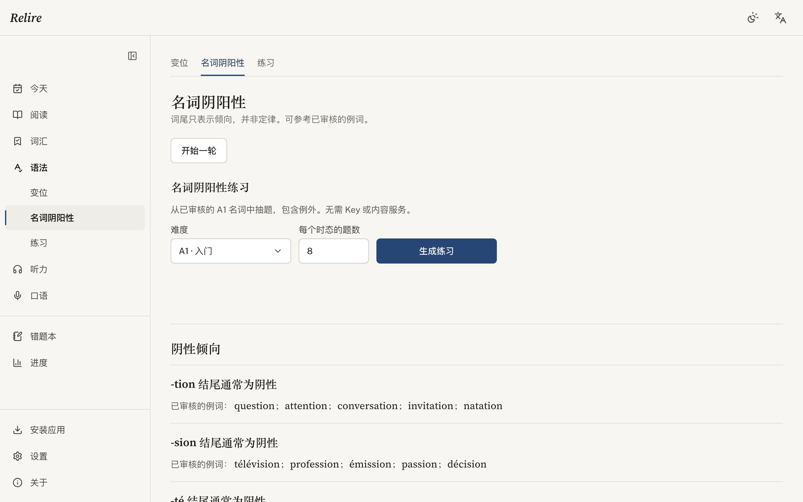
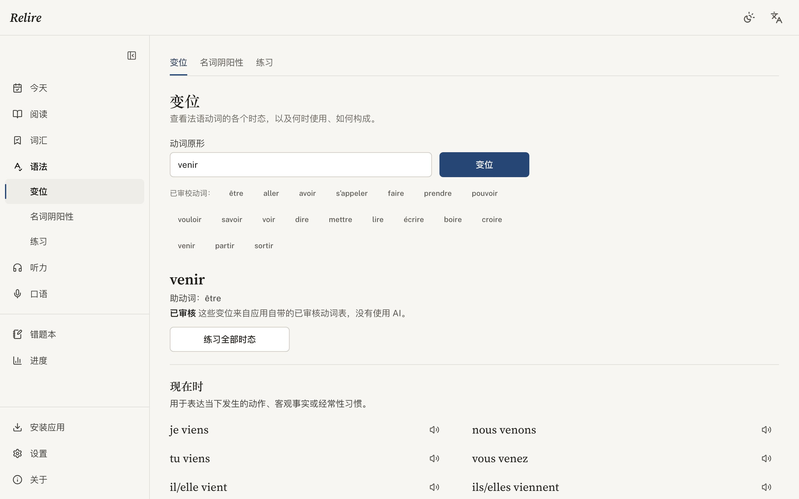

<div align="center">

<a href="https://royisme.github.io/relire/app/"></a>

# Relire

**逐句精读，开口跟读。**

我在备考 TCF Canada，这是我为自己的法语精读做的工具。它在浏览器里运行，无需注册。学习记录保存在你的设备上；用到 AI 功能时，你问的内容会直接发给你选择的服务商。

[**打开 Relire →**](https://royisme.github.io/relire/app/) · [English](README.md)

<sub>文章里的词语和句子解析、发音反馈和 AI 语音，使用你所选提供方的 Key（本地 Ollama 不需要）。
分级读物、已审校的动词变位和名词阴阳性参考不需要 Key。</sub>

</div>

## 读懂，再读出来

**点任意一个词。** 在分级读物里，你会看到词义和它所在的原句，不需要 Key。在你粘贴或导入的文章里，解析还会给出音标、动词形式和例句，这需要文本 AI 的 Key（本地 Ollama 不需要）。

<table>
<tr>
<td width="64%"></td>
<td></td>
</tr>
</table>

**在粘贴或导入的文章里展开一个句子。** 句子拆成带标注的成分，语法要点、常见搭配和跟读指南就放在原文旁边。需要文本 AI 的 Key，或使用不需要 Key 的本地 Ollama。

**跟着读出来。** 播放原句，录下自己的朗读。对比时先播放参考语音，再播放你的录音。每句最近三次录音都保存在你的设备上。录音不需要 Key。分级读物的参考语音用设备语音；其他文章要在设置里选“设备语音”，才能不加 Key 对比。

## 没有 Key？从这里开始

- [分级读物](https://royisme.github.io/relire/app/#/read/graded)：三本入门读物，配编写好的词义、可展开的句子译文、设备语音朗读和阅读检查题（作答记录保存在本机）。
- [名词阴阳性](https://royisme.github.io/relire/app/#/grammar/gender)：17 条词尾倾向，附已审校例词和部分例外，另有判断该用 le 还是 la 的练习。这些倾向依据 Morphalou 3.1 统计，统计结果记录在 `src/data/noun-gender/pack.json`（可用 `bun scripts/readme-numbers.ts` 复现）：-tion 结尾 3,794 个名词里 3,780 个是阴性；-age 3,105 个里 3,091 个是阳性；-ure 1,216 个里 902 个是阴性；337 个例词经过审校。
- [动词变位](https://royisme.github.io/relire/app/#/grammar/conjugation)：19 个已审校动词在应用所支持时态下的变位表，直接从本地数据给出，不调用 AI，另有否定句和疑问句句式。
- [法语音标与近音辨听](https://royisme.github.io/relire/app/#/speaking)：音标表和近音辨听练习。声音通过你所选的语音提供方播放；在设置里选“设备语音”，就能不加 Key 听。

<table>
<tr>
<td width="50%"></td>
<td></td>
</tr>
</table>

## 用你自己的 Key

- **文章解析**：在你粘贴或导入的任何文章里点词、点句，查看语境释义和句子拆解。（文本 AI 的 Key；本地 Ollama 不需要。）
- **发音反馈**：Azure Speech 评测准确度、流利度和逐词表现；Gemini 直接听录音，针对音素、联诵和语调给出意见。评分只是估计值。
- **生成练习**：从你的文章生成填空、选择、词形变换、短文完形、对话排序等题组；开放题由 AI 用文字评判，不打分。
- **文章与练习册识别**：最多从五张照片或 PDF 页面导入，由你选定的视觉模型识别。
- **AI 语音**：Gemini 或 Fish Audio 需要你的 Key；本地 Ollama Phonon 模型只需下载一个模型，不需要 Key 或账号（需要 Apple Silicon 上的 Ollama 0.40.9 及以上版本；40M 模型采用 CC BY-NC 4.0 许可，仅限非商业用途，由学习者自行拉取，不随应用分发）。Ollama 和设备语音不需要 Key。
- **其他动词的变位**：19 个已审校动词之外，变位表由 AI 生成，再与应用自带的规则核对，只标注核对结果，从不标“已验证”。
- **可选内容服务**：一个只读服务，用你自己的访问 Key 下载语法专题和词书页面。它绝不会收到你的 AI Key、答题记录、文章或录音。

## 哪些能信

- **无账号，无应用服务器。** 文章、生词、录音和设置都留在你的浏览器里，AI 请求从浏览器直接发给你选的服务商。唯一的后端是一个可选的只读内容服务。
- **谁审校了什么**：数据文件里记录的审核人是维护者本人，涉及 19 个已审校动词和名词阴阳性包（17 条词尾倾向、337 个例词）。内置的分级读物和拼读发音规则由多个 AI 模型审核，审核所用的模型与生成内容的模型不同。两者都没有人类教师审核，每篇读物在页面上都会这样标明。
- **AI 评分仅为估计值**：AI 给出的发音评分和开放题评判均为估计值，并非官方考试成绩。
- **与官方机构无关**：Relire 是独立的开源练习工具，不是 TCF 模考平台，与 France Éducation international 或加拿大移民部（IRCC）没有任何关联。
- **生词复习基于自主评价**：FSRS-6 间隔重复调度完全依据你自己选择的“不记得”、“模糊”或“记得”，而非程序自动判定。在“玩一轮”模式中，揭晓答案前的回忆答题绝不会改变复习计划。
- **阴阳性练习只记首次作答**：在阴阳性小回合里，只有每张卡片的第一次作答会记入记录；答错后再次出现的卡片，不会重复计入记录。

我指导 AI 编码助手开发了 Relire：代码由它们编写，大部分内容也由它们起草。自动检查覆盖代码、数据结构，以及对照参考数据的动词变位表。分级读物里的法语由其他 AI 模型审核，还没有人类教师审核过。面向初学者发布之前，必须先完成人工语言审核。

## 数据一览

表里的每个数字都来自本仓库；`bun scripts/readme-numbers.ts` 会把它们打印出来。

| 项目 | 数量 | 来源 |
| --- | ---: | --- |
| 内置分级读物 | 3 | `src/data/graded-readers/starter.json` |
| 示例文章 | 3 | `src/data/sampleArticles.ts` |
| 变位库中已审校动词 | 19 | `src/data/grammar-pack/pack.json` |
| 名词词尾阴阳性倾向 | 17 | `src/data/noun-gender/pack.json` |
| 词典中 -tion 结尾为阴性 | 3794 个中的 3780 个 | `src/data/noun-gender/pack.json` |
| 词典中 -age 结尾为阳性 | 3105 个中的 3091 个 | `src/data/noun-gender/pack.json` |
| 词典中 -ure 结尾为阴性 | 1216 个中的 902 个 | `src/data/noun-gender/pack.json` |
| 阴阳性包中已审校名词 | 337 | `src/data/noun-gender/pack.json` |
| 题型种类 | 11 | `src/types/exercises.ts` |
| 界面语言 | 2 | `src/i18n/locales/` |

<details>
<summary>复现各个数字的单行命令</summary>

```bash
bun -e 'console.log((await Bun.file("src/data/graded-readers/starter.json").json()).readers.length)'
grep -c 'id: ' src/data/sampleArticles.ts
bun -e 'console.log(Object.keys((await Bun.file("src/data/grammar-pack/pack.json").json()).verbs).length)'
bun -e 'console.log((await Bun.file("src/data/noun-gender/pack.json").json()).rules.length)'
bun -e 'const p=(await Bun.file("src/data/noun-gender/pack.json").json());const r=p.rules.find(v=>v.id==="tion");console.log(`${r.dictionary.agree} of ${r.dictionary.n}`)'
bun -e 'const p=(await Bun.file("src/data/noun-gender/pack.json").json());const r=p.rules.find(v=>v.id==="age");console.log(`${r.dictionary.agree} of ${r.dictionary.n}`)'
bun -e 'const p=(await Bun.file("src/data/noun-gender/pack.json").json());const r=p.rules.find(v=>v.id==="ure");console.log(`${r.dictionary.agree} of ${r.dictionary.n}`)'
bun -e 'console.log((await Bun.file("src/data/noun-gender/pack.json").json()).nouns.filter(n=>n.prov.status==="reviewed").length)'
grep -cE "^\s+'[A-Z_]+'," src/types/exercises.ts
ls src/i18n/locales/*.json | wc -l | tr -d ' '
```

</details>

## 在线体验

打开 **https://royisme.github.io/relire/app/**。“今天”页、分级读物、名词阴阳性和已审校动词的变位都不需要 Key。AI 解析、AI 语音和发音评分需要你所选提供方的 Key，Ollama 和设备语音除外。

## 快速开始

需要 [Bun](https://bun.sh)。使用 AI 功能还需要上面列出的某个提供方的 Key（Ollama 不需要），例如免费的 [Gemini API Key](https://aistudio.google.com/apikey)。第一次打开时有一个三步引导，可以在里面添加 Key，也可以不用 AI 直接继续。

```bash
git clone https://github.com/royisme/relire.git
cd relire
bun install
bun run dev        # http://localhost:5173
```

`bun run build` 会在 `dist/` 里生成一个普通的静态网站，放到哪里都行（GitHub Pages、Netlify、S3 等）。用 Chrome、Edge 或 Safari 打开后选择浏览器的“安装”选项，它就会在独立窗口里运行。此后保存在你设备上的内容可以离线使用；凡是要调用 AI 服务商或可选内容服务的功能都需要联网，Ollama 只需要你自己的电脑。

### 隐私

- 文章、生词、录音和统计数据保存在这个浏览器的 IndexedDB 里；Key 和设置保存在本地存储里，备份文件不包含 Key。
- 使用 AI 功能时，单词、句子或录音会从你的浏览器直接发给你选择的服务商。
- 可选内容服务绝不会收到你的 AI Key、答题记录、文章或录音。
- 浏览器在空间不足时可能清掉网站数据；请把应用安装成本地应用，并定期导出备份。

完整说明见 [PRIVACY.md](PRIVACY.md)（英文）。

## 技术栈

React 19、Vite、Tailwind CSS 4 和 i18next，应用直接从浏览器调用 AI 服务商的接口。`PRODUCT.md` 说明应用面向谁，`DESIGN.md` 是视觉规范，`AGENTS.md` 是给贡献者的仓库规则、检查和命令。

## 参与贡献

欢迎提 issue 和 PR。修改界面前请先阅读 `PRODUCT.md` 和 `DESIGN.md`，所有面向用户的文案都要同时写进 `src/i18n/locales/en.json` 和 `zh.json`。

## 许可证

代码与文档采用 [MIT](LICENSE)。`data/lexicon/` 下的词典数据文件是基于 Morphalou 3.1 的衍生作品，采用 LGPL-LR 许可证；见 [data/lexicon/NOTICE.md](data/lexicon/NOTICE.md) 与 [data/lexicon/LGPL-LR.txt](data/lexicon/LGPL-LR.txt)。

如果 Relire 对你学法语有帮助，点个 Star，让更多人找到它。
